# Tade — **T**erminal **A**gentic **D**evelopment **E**nvironment

A control room in your terminal for running coding agents and landing what they make — [tade.sh](https://tade.sh).

```sh
curl -fsSL https://tade.sh/install.sh | sh
```


Plenty of things run agents in parallel; the work still has to be read, checked and merged before it
counts. Tade is where agent work becomes merged work, and everything it says about that work is read
back out of git, the checks, the forge and what the agents spent — never graded by the agent that did
it, and never remembered, so closing Tade leaves nothing behind.

**Agents run as you.** Nothing in Tade contains them, so an agent can read and change whatever you
can, including `~/.tade/config.yaml`, where the keys you paste in are kept. Approvals are yours to
turn on, and a key you would rather Tade never wrote down can stay in an environment variable, which
always wins over the file.

## The window

Agents down the left with what each has cost, their changes and files, the agent you are watching in
the middle, the orchestrator along the bottom. One terminal, no browser, no daemon.

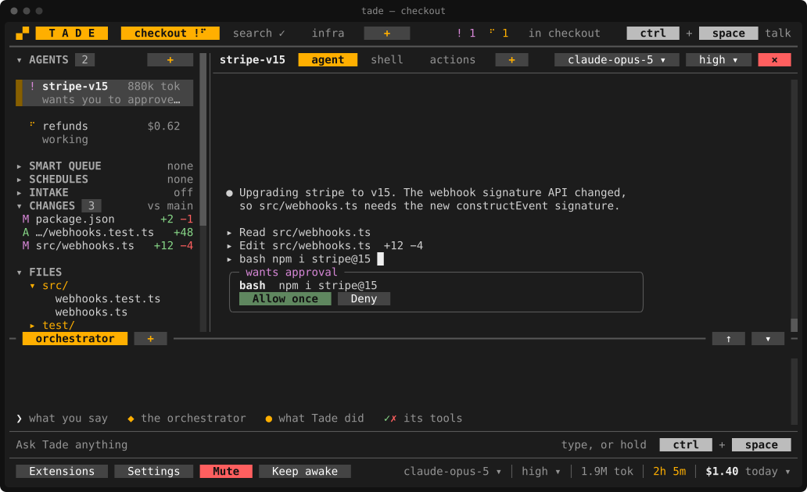

## Agents, together or apart

pi, Claude Code, Codex, or any Agent Client Protocol agent, each in a lane of its own — all in the
project's checkout, or a worktree and branch each. What each one *is* — working, waiting on you,
failed, finished — is read back from git and the processes every time you look.

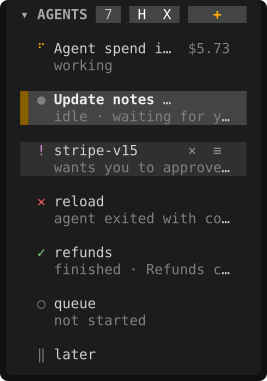

## An orchestrator you talk to

Say or type what you want: it starts, steers and stops agents and shows every tool as it runs,
including the ones that fail, with the reason.

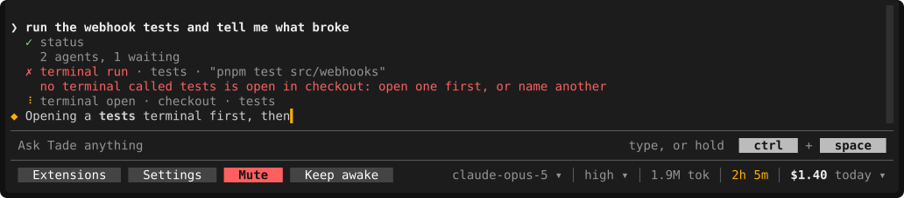

## Voice, first

Hold `ctrl+space` and talk; speech stays on your machine by default. Unmute (`ctrl+m`) and answers
come back as a few spoken sentences.

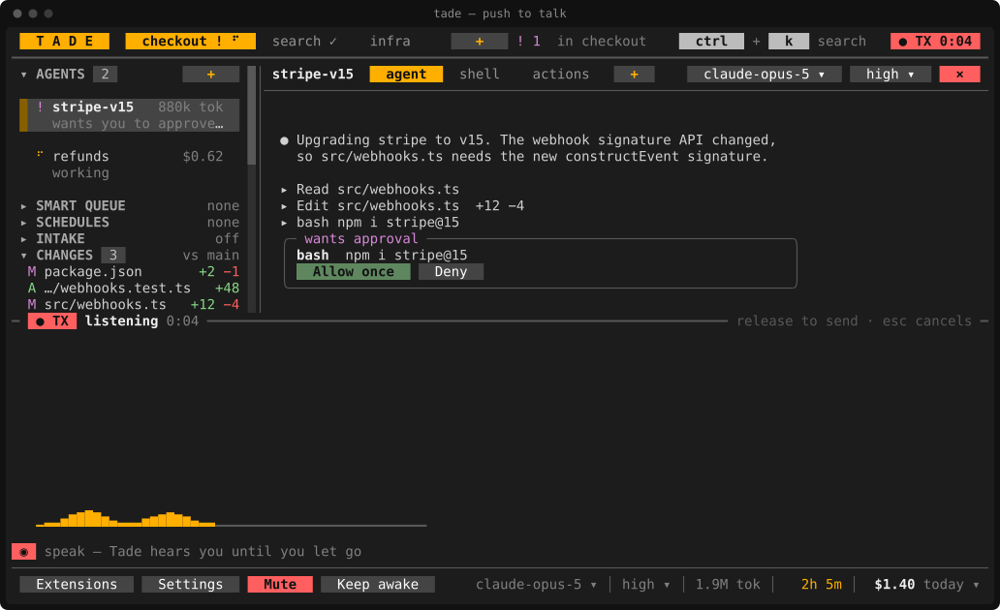

## Collisions, forecast before they happen

Work that would collide — two branches that would not merge, or two agents editing the same file in
one checkout — wears `⇄` on both agents while either can still give way. The orchestrator is told
which side should; the forecast itself never stops anything.

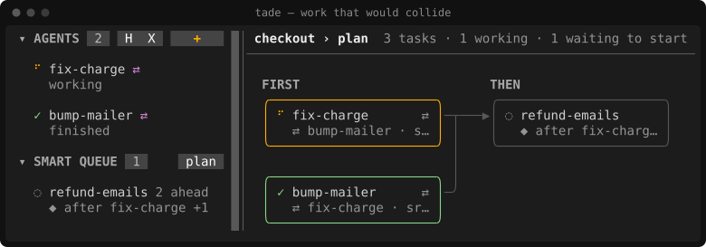

## Changes, tracked as they happen

Every file an agent touches, marked the way git marks it. Click one and it opens in the window's own
editor with the diff drawn in, where you can fix it, or write a comment on a line for Tade or the
agent.

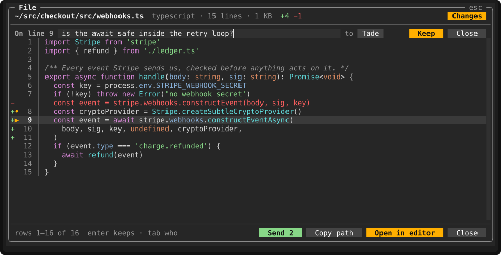

## The checks, before anybody else sees them

Nothing to configure: Tade reads what the project already checks — its CI workflows and commit hook —
runs it here and records each run against its commit. A push with nothing green behind it is held.

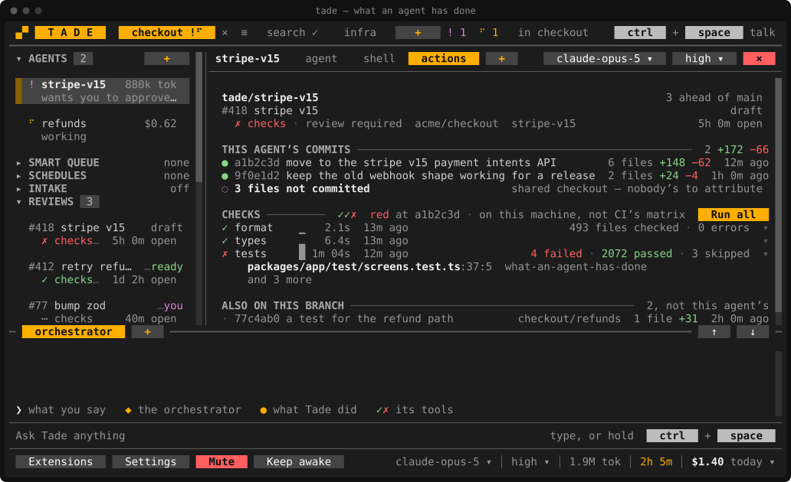

## Jev, a judge whose findings are answered

A cheap judge reads each change once it stops moving — for injection, secrets, swallowed errors,
missing tests and whether it did what was asked. The agent accounts for each finding; the verdict is
yours or the orchestrator's, and a mistake made twice becomes a proposed hook line, lint rule or test.

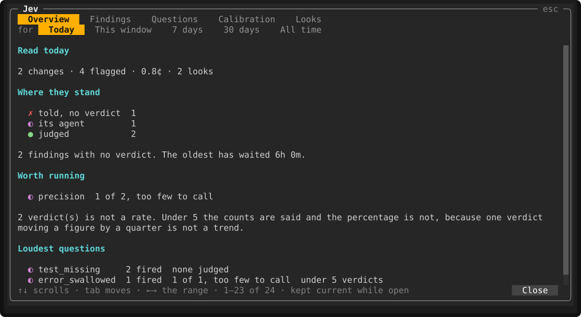

## Evaluations: which way of working lands work

Per harness, model, persona and template: how many agents landed work, how often the first push was
green, and what a landed task cost — counted from what was recorded. `tade eval` replays your own
landed tasks on a candidate model, and a race gives one request to several agents for you to pick.

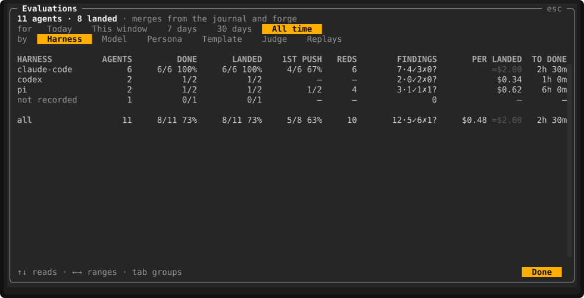

## Reviews, and the loop around them

Your open pull requests, what CI makes of each and the conversations nobody has answered. Watches can
fix what is red and answer the bots; nothing merges unless you asked for exactly that.

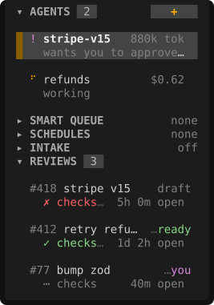

## Spend, time and tokens

What every agent cost in tokens, runtime and dollars, per project against its budget. A subscription
is shown as how much of its window is used and when it resets — never added to the money.

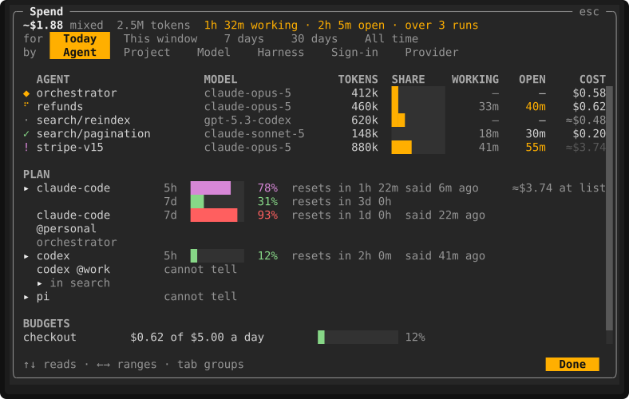

## Smart queues and plans

Ask for five things at once: what can run now runs, and the rest waits for exactly what it needs and
starts by itself. The plan shows every step, every wait and why, before any of it starts.

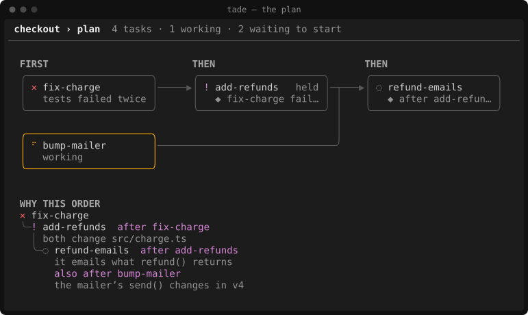

## Schedules and watches

"Every Monday, update our dependencies" becomes a schedule. A watch is a schedule that looks first —
a red `main`, a new Sentry issue, a vulnerable dependency — and puts an agent on each new finding.

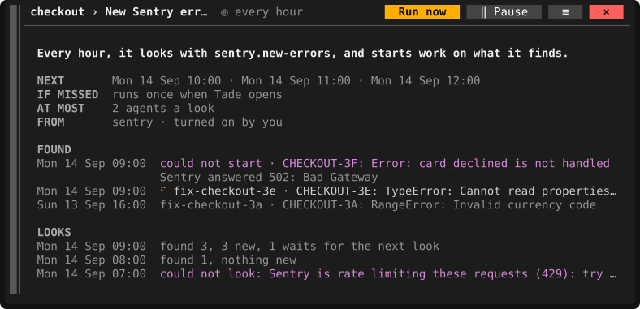

## Work that arrives on its own

A labelled GitHub issue, an `@tade` in Slack, a Linear issue or `tade intake` — each through a door
you opened, under a grant naming whose requests count. What a stranger wrote is material, never
instruction, and by default a person approves each request.

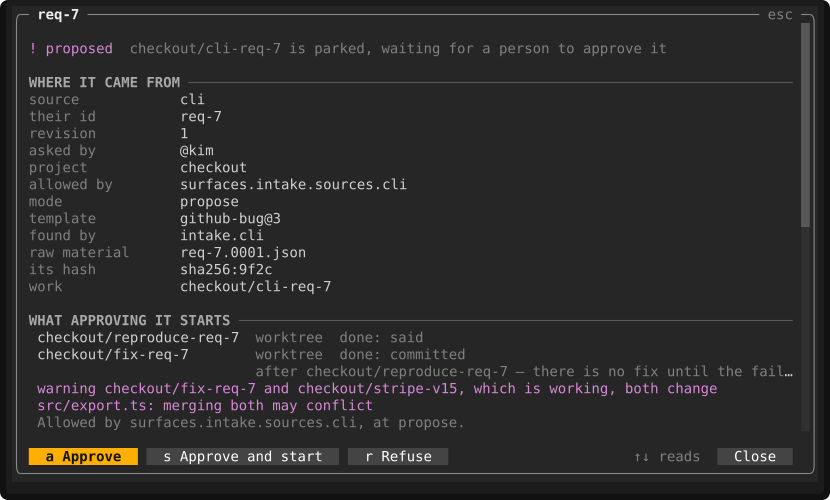

## Approvals, on your terms

Off by default, and every command is written down either way. Turn them on and risky commands stop
and ask — in the window, by voice or from your phone.

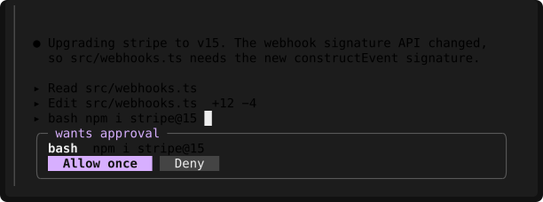

## Many projects, many machines

Projects are tabs along the top, each saying what is happening in it. Projects on a VPS of yours are
tabs too, under that machine's name: open its agents, type into them and talk to its orchestrator
from the Mac.

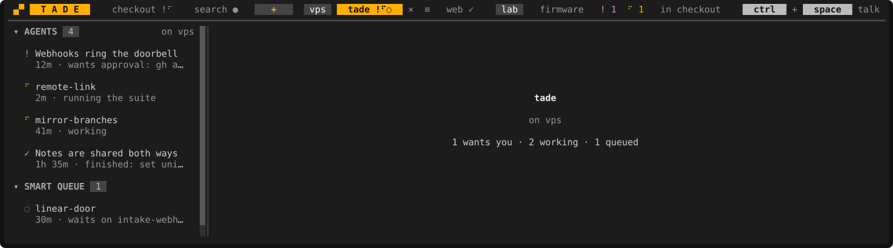

## Context-rich search

`ctrl+k` finds agents, files and lines in every worktree, documents and actions — and what is
*happening*, so `coverage` finds the agent raising it.

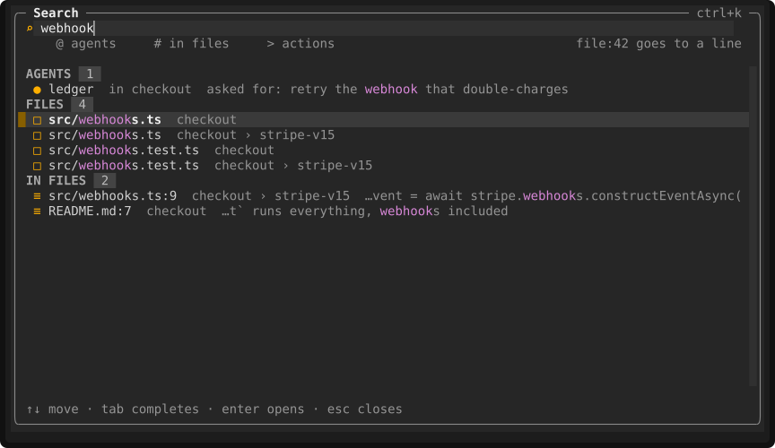

## Notes

Say *"remember the staging key rotates on the 1st"*. Notes are kept word for word, and agents are
given the ones that concern their work.

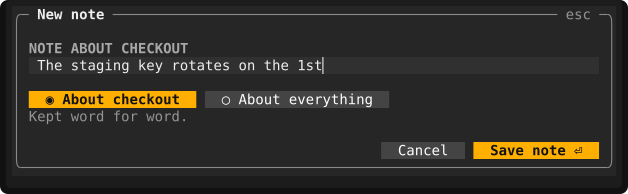

## A remote control on your phone

Pair a phone by scanning a code: an overview of every project, the work that wants you with its
presses on the card, and Tade one tap away. Your own phone, paired with full access, can do whatever
you can at the machine; **Sign out** or `tade web revoke` takes it back.


## Models and accounts

Pick the model for the orchestrator and for new agents. Claude Code and Codex sign in as themselves,
and can run as more than one account — your subscription and your company's — chosen per project.

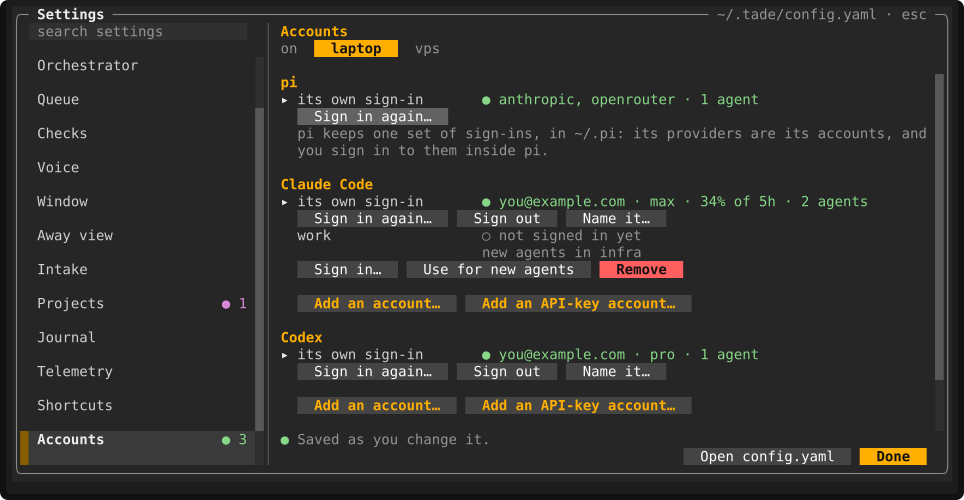

## Extensions and MCP servers

Checks, Dependencies, Jev, Reviews, Sentry and Resources ship with Tade; yours go in
`~/.tade/extensions/`, off until you turn them on. An MCP server you turn on hands its tools to every
agent and the orchestrator, gated by Tade.

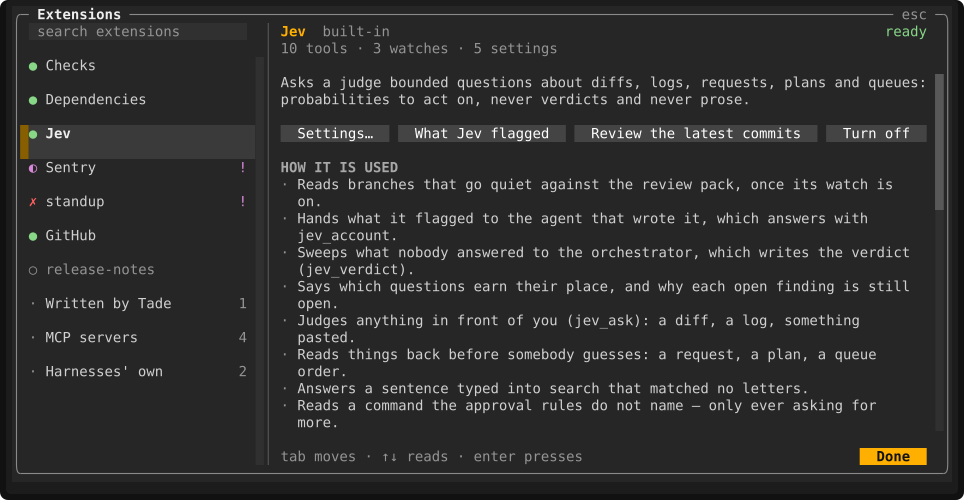

`ctrl+space` talk · `ctrl+k` search · `tab` next agent · `ctrl+n` new agent · `ctrl+t` terminal ·
`ctrl+/` orchestrator · `F1` every shortcut · `ctrl+,` settings

## Planned

- **Time from done to landed**, beside the cost per landed task on Evaluations (`evaluationsFrom`,
  `core/src/evaluations.ts`).

## Installing

One npm package, `tade-sh`; the command is `tade`. macOS and Linux (**Windows is not supported
yet**), Node ≥ 22.19 and git. Every machine runs its own Tade, and the Mac's window drives the others
over SSH.

### On your Mac

```sh
npx tade-sh   # needs Node ≥ 22.19 (nodejs.org, mise or nvm) — nothing to install first, straight into setup
```

That runs Tade out of npx's cache, and the first time it is a short setup in the same terminal. To
keep it, install it: the one-liner installs `tade-sh` with whichever of npm, pnpm or bun you have and
prints the command before it runs it ([read it first](https://tade.sh/install.sh)).

```sh
curl -fsSL https://tade.sh/install.sh | sh
tade                                          # the window; the first time, a short setup
```

Or by hand: `npm install -g tade-sh`, `pnpm add -g tade-sh` or `bun add -g tade-sh`. Nothing is
compiled and nothing asks you to approve an install script: both native modules arrive ready-built,
for macOS and for Linux with glibc 2.28 or newer, on x64 and arm64 (not Alpine).
`tade setup --check` looks at the machine again whenever you like. Optional: tmux 3.2+ (agents that
outlive the window — install Tade for those rather than running it from npx, whose cache npm may
replace under them), whisper.cpp and ffmpeg (speech), `gh`. Any modern terminal runs it; it works
best in [Ghostty](https://ghostty.org).

### On a VPS

Any Debian or Ubuntu box you can reach over SSH, as an ordinary user with sudo:

```sh
sudo apt-get install -y git tmux                           # plus Node ≥ 22.19
curl -fsSL https://tade.sh/install.sh | sh
tade setup                                                 # over SSH: signs each harness in
tade host service                                          # runs `tade serve` under systemd
tade web on                                                # on this machine alone: your Mac pairs through it
```

For a phone and webhooks it needs a name of yours (Caddy 2.7+):

```sh
tade host domain tade.example.com   # the DNS records it needs, each checked
tade host caddy                     # the Caddy site block
tade web on                         # serve the away view behind Caddy
tade web pair                       # a code to scan with your phone
```

### From your Mac to your VPS

```sh
tade remote add vps --ssh vps   # pairs this Mac as the VPS's owner and carries your preferences
tade remote status              # up, down or signed out, and since when
tade remote connect vps         # connect GitHub, Slack and Linear on the VPS's own pages
tade host backup --init <repo>  # restic backups of the VPS; `tade host upgrade` moves it forward
```

## Contributing

```sh
git clone https://github.com/mujacica/tade && cd tade
pnpm install
pnpm run link:global    # puts `tade` on your PATH
```

There is no build step, so `tade` runs the code you have. Changing Tade starts at
[AGENTS.md](AGENTS.md).

## License

MIT — see [LICENSE](LICENSE). Third-party licences are in
[THIRD_PARTY_NOTICES.md](THIRD_PARTY_NOTICES.md).
